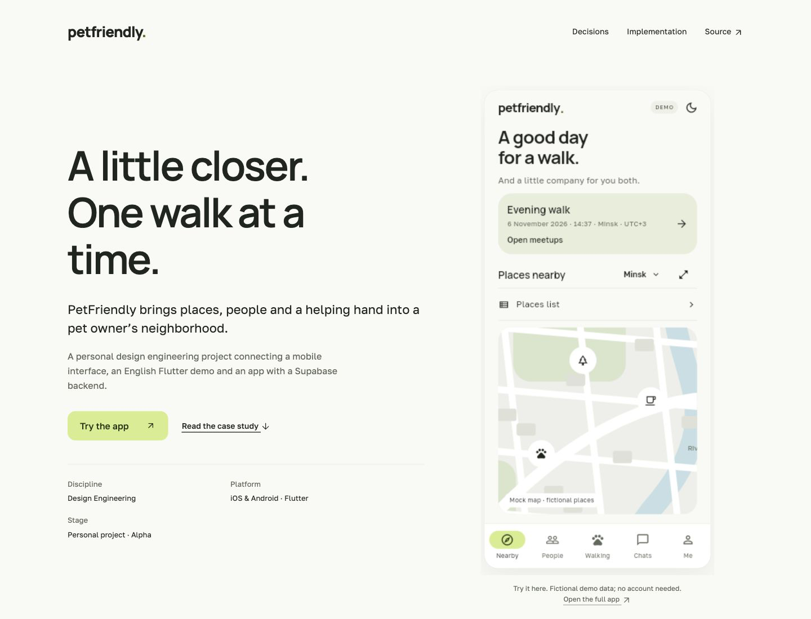

# PetFriendly

**A neighborhood for people and their pets — explored through design and code.**

A personal **Design Engineering** project connecting a Studio visual system, a Flutter application and a Supabase backend. PetFriendly brings together nearby places, people, communities, shared walks, walking assistance and chat.

[**Read the case study →**](https://lambda2331.github.io/PetFriendly/) · [**Try the English Flutter demo →**](https://lambda2331.github.io/PetFriendly/prototype.html) · [**Run locally →**](docs/getting-started.md)



## The same application, in the browser

The public demo compiles the **current Flutter screens and scenario logic** from `lib/`. It replaces the former handwritten HTML imitation. It uses an English build catalog, the existing in-memory demo repositories and an interactive mock map. The native application’s default language and live Mapbox integration are preserved.

Try these journeys:

- **Discover a place:** pan the map, open a marker, inspect details, save a favorite, leave a review or switch to the separate places list.
- **Meet people:** search, open a conversation, send a demo message, browse communities and join meetups.
- **Arrange walking help:** read a request, offer help, create your own request and explore the app’s agreement workflow.
- **Manage a profile:** edit identity, add or edit a pet, view saved places and change appearance in settings.

All people, places, ratings and activity in the portfolio demo are fictional. There is no live authentication, messaging, tracking, payment or production backend connection. The map is a local Flutter rendering with pan/zoom, clickable category markers, fullscreen, simulated position and point selection for adding places. It needs no Mapbox token and makes no map-service requests.

## Design engineering decisions

| Decision | Interface consequence | Implementation |
| --- | --- | --- |
| A shared Studio system | Consistent typography, surfaces and action hierarchy | [Tokens](design/tokens.json), [Flutter theme](lib/core/theme/studio_theme.dart) |
| Shared native/web screens | UI updates no longer require a second HTML implementation | [App](lib/app/app.dart), [feature modules](lib/features/) |
| Explicit demo adapters | Reviewers can explore without accounts or paid services | [Mock map](lib/features/nearby/portfolio_map.dart), [demo repositories](lib/features/community/data/community_repository.dart) |
| Verified English build coverage | New untranslated copy fails the build | [English catalog](tooling/portfolio/en.json), [build script](scripts/build-web-demo.py) |
| Trust enforced beyond UI | Membership-gated chat and agreement-based reviews in backend mode | [Migrations](supabase/migrations/), [functions](supabase/functions/) |

## Build and preview

Requirements: Python 3 and the Flutter SDK version pinned in [CI](.github/workflows/checks.yml).

```sh
git clone https://github.com/lambda2331/PetFriendly.git
cd PetFriendly
python3 scripts/build-portfolio.py
python3 scripts/build-web-demo.py --base-href /app/
python3 -m http.server 4173 --directory portfolio
```

Open [localhost:4173](http://localhost:4173). The English application is compiled into ignored `portfolio/app/`; CI rebuilds it for the `/PetFriendly/app/` GitHub Pages path. Set `PETFRIENDLY_FLUTTER_BIN` if Flutter is not on your PATH.

For the native app:

```sh
flutter pub get
flutter run --dart-define=USE_DEMO_DATA=true
```

See the [setup guide](docs/getting-started.md) for the distinction between the native preview and seeded English portfolio mode.

## English without a separate UI fork

`tooling/portfolio/en.json` contains reviewed translations of Dart literal text segments. The build creates an ignored copy of the canonical source, localizes text while preserving interpolation expressions and compiles it with `PORTFOLIO_DEMO=true`. Missing translations fail the build. Native source strings remain unchanged, and native builds keep their current language.

The English build is a compile-time portfolio adaptation, not a runtime language switch. Internal geographic search aliases remain in their original script; they are not visible interface copy. `source-manifest.json` in the published application records the canonical source digest and build mode.

## Status and verification

This is an alpha and portfolio demonstration. Research, product adoption, production readiness and live service delivery are not established by the demo. External authentication, cloud push, account security operations and private server storage require real service configuration; the public demo does not claim to exercise them.

```sh
python3 scripts/build-portfolio.py --check
python3 tooling/portfolio/test_localization.py
python3 scripts/check-portfolio.py
flutter analyze
mkdir -p docs/screenshots tooling/.logs
flutter test
```

[Portfolio Pages](.github/workflows/pages.yml) checks translation coverage, builds Flutter web and deploys the case study plus app. [Flutter CI](.github/workflows/checks.yml) continues to validate the native source.

- [Case study](docs/case-study.md)
- [Architecture](docs/architecture-overview.md)
- [Demo scope and limitations](docs/portfolio-status.md)
- Historical specifications: [design](docs/design.md), [architecture](docs/architecture.md), [security](docs/security.md), [development log](docs/progress.md) — Russian

## Repository structure

```text
lib/                       Shared Flutter screens, state and repositories
lib/features/nearby/        Native maps and portfolio mock-map adapter
web/                       Flutter web bootstrap
portfolio/                 Case study and thin Flutter demo host
portfolio/app/             Ignored compiled application (built by CI)
tooling/portfolio/         English catalog, literal scanner and tests
assets/                    Bundled fonts and source-attributed native catalog
design/                    Tokens, settings and demo redirect
supabase/                  SQL migrations and Edge Functions
test/                      Flutter unit and widget tests
integration_test/          Native integration scenarios
scripts/                   Build and backend verification tools
```

## Attribution

Manrope and Golos Text are bundled under their [SIL Open Font Licenses](assets/fonts/). Flutter supplies Material icons. Native maps use Mapbox and the native catalog retains OpenStreetMap provenance and attribution. The mock map and fictional portfolio places do not use external map tiles or an OSM catalog export.

No repository-wide software license has been selected. Third-party asset licenses apply to their respective assets.
