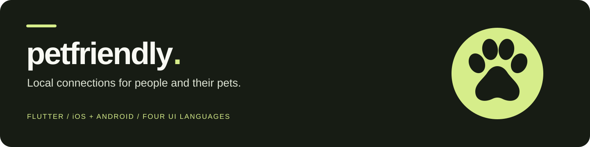
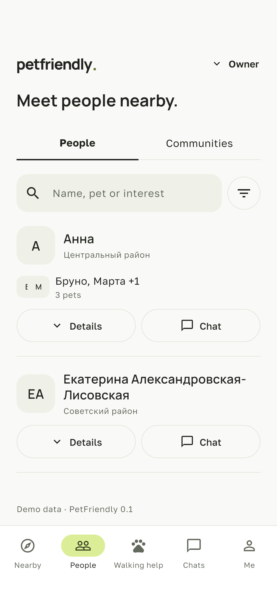
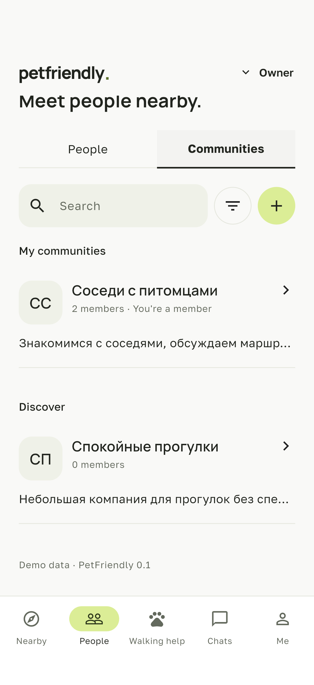
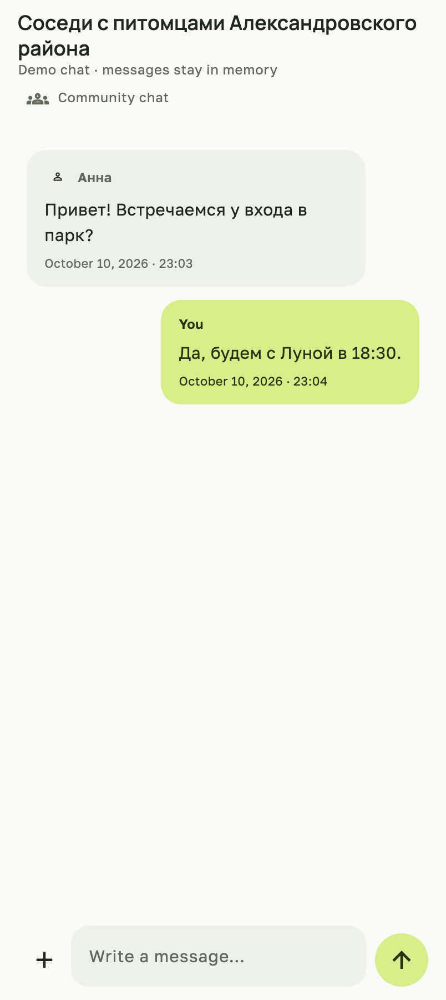

<p align="center"></p>

<p align="center"><strong>Places to explore. People to meet. Help with the next walk.</strong><br>A Flutter application for local pet communities on iOS and Android.</p>

<p align="center">English · <a href="README.ru.md">Русский</a></p>

<p align="center"><a href="#product">Product</a> · <a href="#preview">Preview</a> · <a href="#quick-start">Quick start</a> · <a href="docs/PROJECT_OVERVIEW.md">Architecture</a> · <a href="docs/READINESS.md">Readiness</a></p>

| Platforms | Interface | Foundation | Stage |
| --- | --- | --- | --- |
| iOS · Android | English · Russian · Belarusian · Polish | Flutter · Supabase · Mapbox | Pre-launch · Pre-revenue |

PetFriendly connects pet owners with nearby places, communities, meetups and walking assistance. One account can be an owner, a helper, or both. Helpers have a focused experience and do not need a pet of their own.

This private repository contains a development snapshot for technical review and handover. Demo content is synthetic. Production configuration, acceptance and customer acquisition remain part of the next stage. Read the [readiness notes](docs/READINESS.md) before treating a flow as launch-ready.

## Product

| Area | Implemented in the development code |
| --- | --- |
| Nearby places | City selection, map integration, searchable place list, filters, details, favorites and reviews |
| People and communities | Profiles, pets, discovery, participation and invitations |
| Meetups | Discovery, creation, participant flows, chat sharing and an optional public gathering point |
| Walking assistance | Owner/helper roles, requests, applications, agreements, availability and eligible reviews |
| Chat | Participant conversations, agreement context and photo-only upload implementation |
| Preferences | Light, dark and system themes; local language and manual-city preferences |

The first launch market is Minsk. The international directory contains **34,156 cities across 244 country and territory codes**, with aliases and IANA time zones. Directory coverage does not establish live map availability in every country or a complete worldwide venue catalog.

Platform payments, live location tracking and AI matching are outside the current release scope.

## Preview

<table>
<tr><td align="center"></td><td align="center"></td><td align="center"></td></tr>
<tr><td align="center">People · native iOS capture</td><td align="center">Communities · native iOS capture</td><td align="center">Chat · Flutter widget render</td></tr>
</table>

Earlier captures from the October 2026 sales materials, using sample data; they are not fresh renderings of this branch. Names and messages retain their original language. Browser design references and native application rollout have separate histories.

## Quick start

Install Flutter **3.47.6** and the platform tools for your device. This is the SDK used for the recorded project checks; package constraints are in [pubspec.yaml](pubspec.yaml).

```sh
git clone https://github.com/lambda2331/PetFriendly.git
cd PetFriendly
git checkout codex/repository-packaging
flutter pub get
flutter devices
flutter run -d <device-id>
```

The default is demo mode. No service credentials are required for this first run. Ordinary demo community/chat/walking lists start empty; integration fixtures are not persistent demo accounts. Map rendering requires a public Mapbox token and otherwise shows an unavailable state. The bundled Minsk catalog contains 130 parks/dog parks.

For configuration and local Supabase, follow [Getting started](docs/GETTING_STARTED.md). Use your own service accounts and keep credentials in ignored local files.

## Engineering

| Layer | Tools |
| --- | --- |
| Application | Flutter / Dart, feature-first structure |
| State and navigation | Riverpod, go_router |
| Backend | Supabase Auth, PostgreSQL + PostGIS, SQL RPCs, Edge Functions |
| Messaging and media | Realtime integration, private Storage, participant authorization |
| Geography | Mapbox, OpenStreetMap venue data, GeoNames city directory |
| Notifications | Firebase/FCM; iOS requires APNs configuration |
| Localization and time | ARB/gen-l10n, locale-aware formatting, IANA venue zones |
| Visual system | Studio, Manrope + Golos Text, semantic tokens |

```text
lib/                Flutter application, organized by feature
assets/             Fonts, icons and attributed geographic data
android/ · ios/     Native platform projects
supabase/           Migrations, functions and local backend configuration
test/               Unit and widget tests
integration_test/   Native journeys and fixture-based verification
test_driver/        Native screenshot and integration drivers
scripts/            Development and verification utilities
design/             Browser sources and preserved design review versions
config/             Examples; local credentials are ignored
docs/               Setup, architecture, readiness and handover
```

Generated browser builds and bulk archived check outputs are omitted from this package. Preserved design source versions remain available; a design proposal is not automatically approved or implemented.

## Verification

```sh
flutter analyze
flutter test --concurrency=1
node --experimental-strip-types scripts/check-international-geocoding.mjs
```

Current [package checks](docs/PACKAGE_CHECKS.md) retain an unresolved meetup-navigation test failure. Native journeys and server checks need their own environments. Some historical integration targets no longer match the UI; a prior native compact-chat stress case exposed a layout overflow. The [readiness record](docs/READINESS.md) separates recorded results, open issues and unverified production services. Demo tests do not certify a complete cloud journey or security.

## Documentation

| Guide | Purpose |
| --- | --- |
| [Getting started](docs/GETTING_STARTED.md) | Demo, configuration and local backend |
| [Project overview](docs/PROJECT_OVERVIEW.md) | Product, source layout and architecture |
| [Readiness](docs/READINESS.md) | Evidence and remaining launch work |
| [Package checks](docs/PACKAGE_CHECKS.md) | Results recorded for this review branch |
| [Handover](docs/HANDOVER.md) | Review access, inventory and transfer preparation |
| [Security baseline](docs/security.md) | Account, authorization and data requirements |
| [Walking API](docs/walking-api.md) | Roles, agreements and reputation contracts |
| [Internationalization](docs/internationalization.md) | Languages, city identities and time zones |
| [Design system](docs/design-system.md) | Approved visual foundations and components |
| [Third-party notices](THIRD_PARTY_NOTICES.md) | Data, fonts and service obligations |

The guides created for onboarding and handover are in English. Some detailed historical engineering/design documents are in Russian.

## Project acquisition

PetFriendly is offered as a pre-launch product/source-code asset. The [SideProjectors listing](https://www.sideprojectors.com/project/101289/petfriendly-flutter-pet-community-app) has an asking price of **USD 7,900, negotiable**. Final inventory, transition support and transaction terms require agreement with the owner.

The proposed assets include application source, backend implementation, original design materials, localization resources, tests and documentation. Credentials, personal service/developer accounts and private user records are excluded. See [Handover](docs/HANDOVER.md).

## Rights and attribution

This repository does not grant an open-source license to the original project code or design. Access and any transfer of rights are subject to the owner's agreement. Third-party materials retain their own licenses; review [THIRD_PARTY_NOTICES.md](THIRD_PARTY_NOTICES.md) before redistribution.
