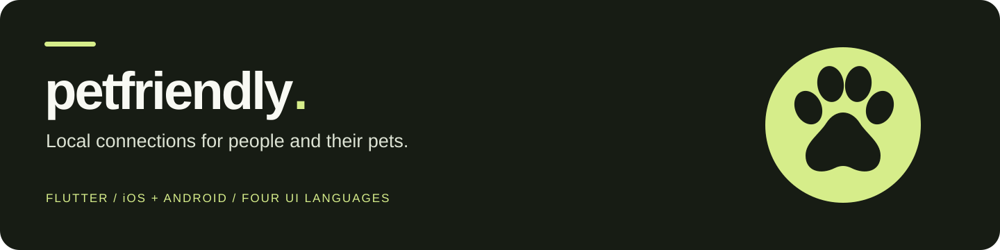

<p align="center"></p>

<p align="center"><strong>Места для прогулок. Люди рядом. Помощь с питомцем.</strong><br>Мобильное приложение на Flutter для iOS и Android.</p>

<p align="center"><a href="README.md">English · Buyer overview</a></p>

## Что такое PetFriendly

PetFriendly объединяет владельцев питомцев в городе: помогает находить места, знакомиться, создавать сообщества и встречи, договариваться о помощи с выгулом. Один аккаунт может использоваться владельцем, помощником или в обеих ролях. Помощнику не обязательно иметь своего питомца.

Первый рынок — Минск. Интерфейс поддерживает русский, английский, белорусский и польский языки, а справочник — 34 156 городов с кодами 244 стран и территорий. Это покрытие справочника, а не гарантия доступности карт и полноты мест во всех странах.

## Что входит в проект

| Направление | Возможности в коде разработки |
| --- | --- |
| Места рядом | Выбор города, карта, список, фильтры, избранное и отзывы |
| Люди и сообщества | Профили, питомцы, поиск, участие и приглашения |
| Встречи | Поиск, создание, участие, передача в чат и публичная точка сбора |
| Помощь с выгулом | Роли владельца и помощника, заявки, отклики, договорённости и отзывы |
| Общение | Чаты участников, контекст договорённости и загрузка фотографий |
| Настройки | Четыре языка, светлая/тёмная/системная тема, сохранение ручного города |

В репозитории собраны Flutter-приложение, проекты iOS/Android, backend Supabase, миграции, тесты, локализация, исходники дизайна и документация. Архитектура построена вокруг отдельных функций продукта, Riverpod и go_router. Карты используют Mapbox, данные мест — OpenStreetMap, справочник городов — GeoNames.

Скриншоты и подробное описание доступны в [английском README](README.md#preview).

## Как запустить

Проверенная версия SDK: Flutter 3.47.6 / Dart 3.13.5.

```sh
git clone https://github.com/lambda2331/PetFriendly.git
cd PetFriendly
git checkout codex/repository-packaging
flutter pub get
flutter devices
flutter run -d <device-id>
```

По умолчанию запускается деморежим. Социальные списки, чаты и заявки в нём изначально пустые; тестовые аккаунты не сохраняются как готовая база пользователей. Для отображения карты нужен собственный публичный токен Mapbox. Без токена приложение показывает состояние недоступности карты. В поставку включён каталог 130 парков и площадок Минска.

Параметры подключения и запуск локального Supabase описаны в [Getting started](docs/GETTING_STARTED.md). Локальные ключи и материалы подписи исключены из пакета.

## Стадия и готовность

Это проект до публичного запуска и выручки. Наличие кода, макета или успешного локального теста не подтверждает готовность всей цепочки в production. Для выпуска остаются настройка и приёмка облачных сервисов, входа, уведомлений, публикации в магазинах, правил сервиса и обработки данных. Старые браузерные и нативные проверки имеют разные границы применимости.

Свежие результаты упаковки находятся в [Package checks](docs/PACKAGE_CHECKS.md), история проверок и ограничения — в [Readiness](docs/READINESS.md). Платежи, постоянное отслеживание геолокации и AI-подбор не входят в согласованный первый выпуск.

## Передача покупателю

Проект [выставлен на SideProjectors](https://www.sideprojectors.com/project/101289/petfriendly-flutter-pet-community-app) за **$7 900, торг возможен**. Финальные условия, состав активов и объём поддержки согласуются отдельно.

Передача предполагает исходники приложения и backend, оригинальные материалы дизайна, переводы, тесты и документацию. Личные аккаунты сервисов, ключи, сертификаты и приватные данные пользователей не входят в предложение. Порядок проверки и передачи описан в [Handover](docs/HANDOVER.md).

Репозиторий приватный. Публикация кода под открытой лицензией не согласована; доступ к нему сам по себе не передаёт права. У сторонних данных и шрифтов сохраняются собственные лицензии: [Third-party notices](THIRD_PARTY_NOTICES.md).
