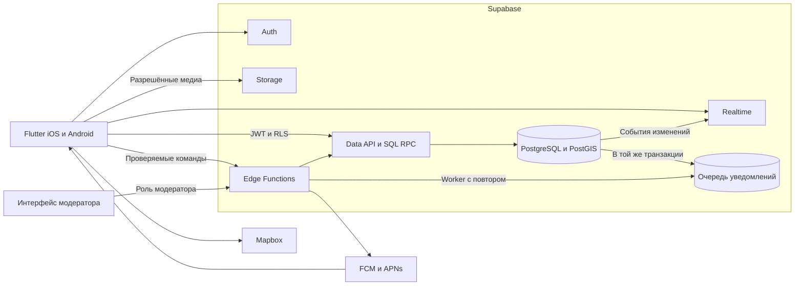
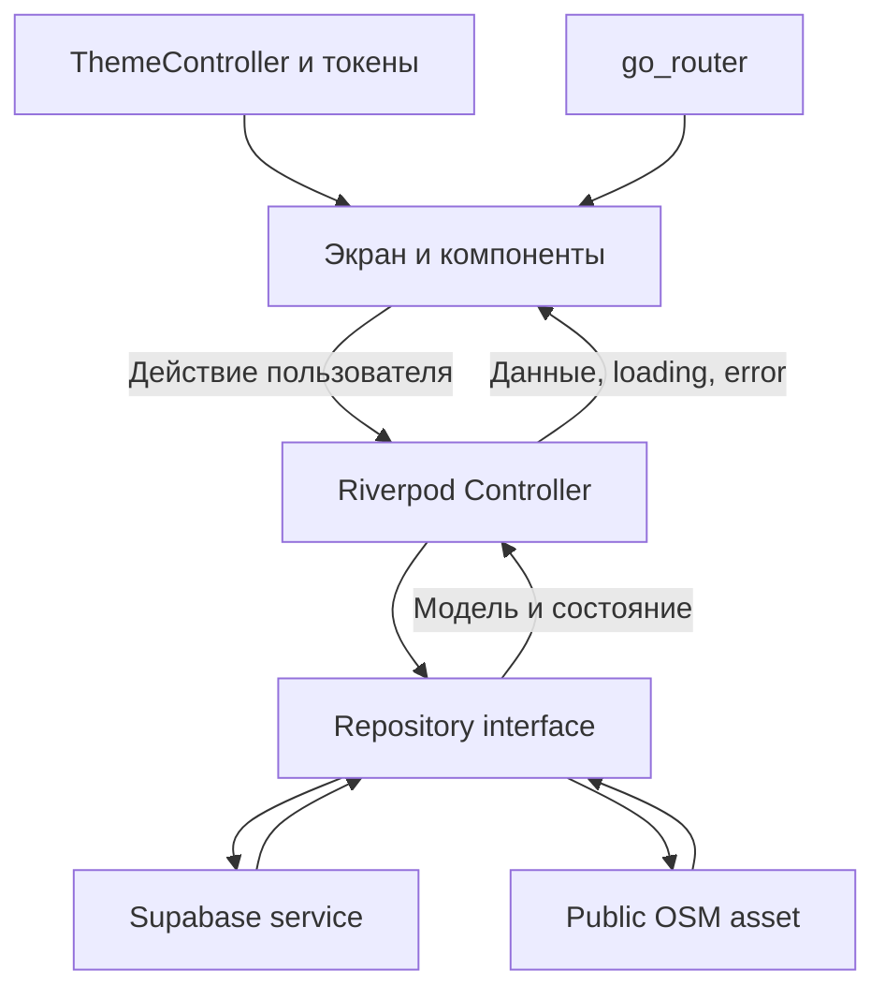
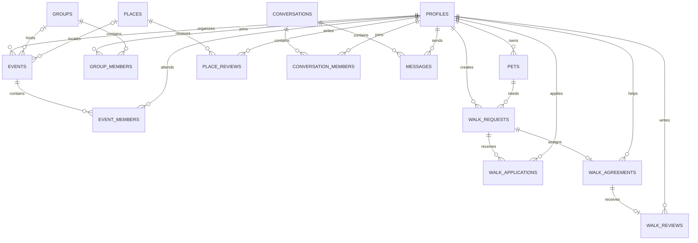
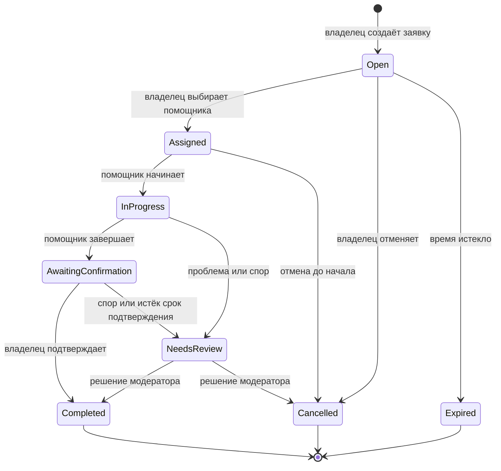
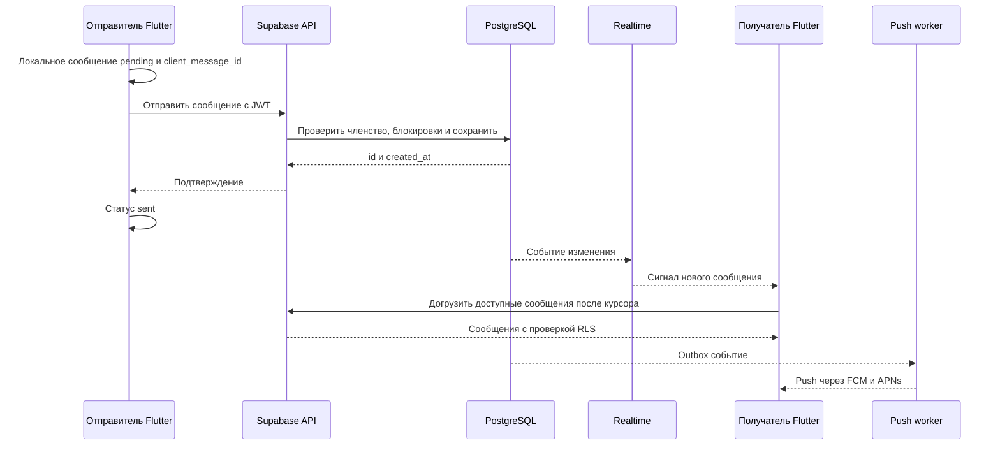

# Архитектура PetFriendly

Версия 1.0 · 8 октября 2026 года. Первая версия использует Flutter для iOS и Android и управляемый backend Supabase. Карта — Mapbox; уведомления — FCM с настройкой APNs для iOS. Это архитектурная спецификация и основа локальной альфы. Supabase, email-вход и серверные сценарии реализованы локально; внешние OAuth, Mapbox и push требуют конфигурации. Текущие ограничения — в progress.md. [Запуск прототипа](development.md).

## Стек

| Область | Решение |
|---|---|
| Клиент | Flutter stable и Dart; версии фиксируются при создании приложения |
| Состояние и зависимости | Riverpod |
| Навигация | go_router, отдельные ветки вкладок |
| Модели | Freezed и json_serializable при необходимости генерации |
| Backend SDK | supabase_flutter |
| Данные и геопоиск | PostgreSQL + PostGIS |
| Вход | Supabase Auth; email + пароль, Google, Apple, Telegram через custom OIDC |
| История чатов | PostgreSQL; Realtime для сигналов обновления |
| Медиа | Supabase Storage, правила доступа и короткоживущие ссылки |
| Серверные действия | SQL RPC для транзакций; Edge Functions для интеграций |
| Карта | mapbox_maps_flutter; независимые стили для тем |
| Геолокация | geolocator, доступ при использовании приложения |
| Push | firebase_messaging; APNs на iOS |
| Кеш | Публичный OSM asset; Drift запланирован, приватные данные не сохраняются |
| Сборка | GitHub Actions; macOS runner для iOS |

Использование разделённых UI/data слоёв и репозиториев соответствует [рекомендациям Flutter](https://docs.flutter.dev/app-architecture/recommendations). Riverpod — выбранный механизм управления состоянием проекта, а не обязательное требование Flutter.

## Стартовый город и карта

Первый рынок запуска и город по умолчанию — Минск, Беларусь. Начальная область карты определяется по координатам устройства с разрешения пользователя. При отказе, ошибке или недоступной геолокации предлагается ручной выбор города; Минск — вариант по умолчанию. Выбранный вручную город сохраняется и не переопределяется геолокацией без действия пользователя. Определение названия города и поиск координат ручного выбора выделяются в отдельный geocoding service с учётом квот; локальная геолокация сама по себе не возвращает название города. Часовой пояс события определяется местом встречи, для Минска — Europe/Minsk; преобразование при отображении обозначается явно.

Mapbox используется в пределах бесплатных квот; платное потребление не согласовано. На 8 октября 2026 года Maps SDKs for Mobile включает бесплатную квоту до 25 000 активных пользователей карты в месяц. У поиска, геокодирования и других API отдельные квоты. Бесплатный объём не является гарантией автоматического отключения платного потребления: перед подключением проверяются ограничения аккаунта, мониторинг и способ остановить расход. Квоты не зашиваются как неизменные значения. [Тарифы Mapbox](https://www.mapbox.com/pricing).

## Источники существующих мест

Согласованный источник начального каталога MVP — OpenStreetMap: парки leisure=park, площадки leisure=dog_park, зоомагазины shop=pet и ветклиники amenity=veterinary. Кафе и рестораны добавляются пользователями через модерацию. Признак dog=yes, dog=leashed или dog=no хранится отдельно от категории; отсутствие признака означает «Допуск питомцев не уточнён». Парк не становится автоматически pet-friendly, а разрешение собак не распространяется автоматически на всех животных. [Теги OSM](https://wiki.openstreetmap.org/wiki/Key:dog).

Импорт возможен серверным заданием через Overpass API или региональную выгрузку, после проверки качества данных Минска. [Overpass API](https://wiki.openstreetmap.org/wiki/Overpass_API). Импорт хранит source, source_id, source_updated_at, imported_at и исходные теги; повторный импорт обновляет тот же объект и не перезаписывает вручную проверенные сведения. Название и координаты используются для поиска возможных дублей, но не как единственный ключ. Данные OSM распространяются по ODbL: требуется атрибуция и соблюдение условий распространения производной базы. Исходный каталог и пользовательские отзывы имеют явную раздельную структуру; перед публикацией проверяется применимость условий лицензии. [Лицензия OSM](https://www.openstreetmap.org/copyright).

Mapbox остаётся подложкой карты. Данные Search Box API рассчитаны на временное использование; постоянное сохранение требует согласования с Mapbox. Поэтому этот API не используется как источник массового постоянного импорта при текущем бесплатном бюджете. [Ограничения Search Box](https://docs.mapbox.com/api/search/search-box/).

Пользовательские рейтинги, комментарии и фото создаются внутри PetFriendly; чужие отзывы автоматически не копируются. Заведениям присваивается статус подтверждения допуска питомцев с источником и датой проверки. Пользователи и владельцы могут предложить исправления; неуточнённые места не включаются в фильтр «Подтверждённый вход с питомцами». Импорт пока не выполнен, количество и полнота доступных мест в Минске не проверены.

## Способы входа

Email + пароль с подтверждением адреса, Google (вход через Google-аккаунт, включая Gmail), Apple и Telegram входят в план MVP. Google и Apple подключаются как встроенные провайдеры Supabase. Запрашиваются только сведения для входа; доступ к почте Gmail не нужен. [Провайдеры Supabase](https://supabase.com/docs/guides/auth/social-login).

Telegram поддерживает OIDC с PKCE. Для интеграции планируется custom OIDC provider Supabase с email_optional=true: Telegram не выдаёт email в описанном login flow. Идентичность определяется по проверенным iss + sub, не по username. Требуются бот, Client ID/Secret и зарегистрированные callback URL; секрет остаётся на сервере. Запрашиваются openid и минимально необходимые сведения профиля, без телефона и разрешения писать от бота. Совместимость мобильного redirect и Supabase проверяется на staging до подключения кнопки к реальным аккаунтам. [Telegram Login](https://core.telegram.org/bots/telegram-login), [Supabase custom providers](https://supabase.com/docs/guides/auth/custom-oauth-providers).

Способы входа связываются с одним внутренним user_id после подтверждения контроля над обеими идентичностями. Apple relay email и отсутствие email у Telegram поддерживаются; совпадение имени или текста email не является самостоятельным основанием для объединения аккаунтов.

## Система



Обычные чтения и изменения выполняются через Data API с RLS. RPC принимает JWT пользователя и проверяет полномочия в базе. Edge Functions проверяют токен и права перед привилегированным действием. Секретные ключи Supabase и push находятся только на сервере. Mapbox получает публичный токен с минимальными разрешениями.

PostGIS выполняет поиск по радиусу и видимой области, с пространственными индексами; карта получает только доступные точки в текущем viewport. [Документация PostGIS в Supabase](https://supabase.com/docs/guides/database/extensions/postgis).

## Flutter приложение



Структура будущего приложения:

```text
lib/
  app/                 # запуск, маршруты, зависимости
  core/
    theme/             # цвета, типографика, motion
    ui/                # общие компоненты
    network/           # SDK и обработка ошибок
    storage/           # локальные настройки и кеш
  features/
    auth/
    onboarding/
    profiles/
    pets/
    nearby/
    places/
    community/
    events/
    walks/
    chat/
    reviews/
    settings/
```

В каждой функции: presentation (экраны/controllers), data (репозитории/services/models). Отдельные domain use cases добавляются для сложных многошаговых сценариев. Управление состояниями и сетевые операции не помещаются в виджеты. При выходе очищается кеш аккаунта; сообщения другого пользователя не остаются доступными следующей сессии.

## Модель данных



Идентификаторы — UUID, даты хранятся в UTC и отображаются в часовом поясе пользователя. Координаты мест — geography(Point, 4326) с GiST индексом. Для групп, мероприятий и заявок задаются категории, статусы и правила участия.

| Таблицы | Значимые поля и ограничения |
|---|---|
| profiles, pets | auth user_id, имя, район, интересы; у питомца owner_id, вид, характер и особенности |
| places, place_reviews | координаты, категория, статус модерации; rating 1–5, уникальный автор на место |
| groups, group_members | правила, видимость, роль; уникальная пара group_id + user_id |
| events, event_members | организатор, время, место, вместимость; запись атомарна, лимит проверяется сервером |
| walk_requests | владелец, питомец, время, длительность, район, статус; отдельные приватные инструкции |
| walk_applications | заявка и помощник; уникальная пара request_id + helper_id |
| walk_agreements | уникальный request_id, назначенный helper_id; одна договорённость на заявку |
| walk_reviews | уникальный agreement_id; author_id = владелец, rating 1–5, комментарий, статус модерации, ответ помощника; только после completed |
| conversations, conversation_members | тип direct/group/event/walk; связь с контекстом, активное членство, last_read_message_id |
| messages | conversation_id, sender_id, body, created_at; уникальная пара sender_id + client_message_id |
| blocks, reports | блокирующий и заблокированный; автор жалобы, тип объекта и причина |
| favorites | пользователь и место; уникальная пара user_id + place_id |
| device_tokens, notification_outbox | токен устройства, пользователь, настройки; id события, попытки, время повтора |

Приватное место передачи питомца хранится отдельно от публичной заявки. У групповых и событийных чатов связь с родителем проверяется FK; одному родителю соответствует один чат. Для direct-чата каноническая пара участников исключает дублирование.

## Выгул



Принятие отклика — одна транзакция: блокировка строки заявки, проверка owner_id и статуса open, проверка действующего отклика, создание единственной договорённости, обновление статуса, создание чата/участников и события outbox. Повтор команды с тем же ключом возвращает ранее созданную договорённость. Конкурирующая команда получает конфликт и обновляет экран. Назначенный помощник не совпадает с владельцем питомца.

Точные инструкции доступны владельцу, назначенному помощнику и уполномоченному модератору по обращению. Отзыв возможен после completed; рейтинг вычисляется сервером. Уведомление о назначении доставляется после успешного commit и не определяет результат операции.

## Рейтинг помощников по выгулу

Рейтинг показывается в профиле пользователя в роли помощника, в карточке помощника и рядом с откликом на заявку. Он отражает опыт завершённых договорённостей. Рейтинги мест рассчитываются независимо.

Владелец оценивает назначенного помощника после статуса completed: 1–5 звёзд и необязательный комментарий. Предлагаемые темы комментария — пунктуальность, соблюдение договорённостей и общение. Предварительное предложение — отзыв в течение 14 дней после завершения; срок будет утверждён вместе с правилами. ответ помощника публикуется отдельно. До назначения или завершения выгула оценка недоступна. Помощник может пожаловаться на отзыв, но не удалить его самостоятельно.

Сервер проверяет владельца заявки, назначенного помощника, completed, срок публикации и отсутствие предыдущего отзыва. Запрещены оценки себя и произвольных незнакомых пользователей. Получатель оценки определяется по договорённости, а не переданному клиентом user_id. Уникальный agreement_id предотвращает повторную оценку той же прогулки.

Профиль содержит среднюю оценку опубликованных допустимых отзывов, их количество и число завершённых выгулов. Среднее округляется до одного знака только при отображении. Без отзывов показывается «Пока нет отзывов»; новые пользователи не получают нулевой рейтинг. Для сортировки используется точное среднее, количество отзывов доступно в фильтрах и отображается рядом с оценкой. Пользователи без рейтинга остаются в выдаче, со знаком нового помощника.

Агрегаты вычисляются сервером через представление или обслуживаемую сервером таблицу; клиент не может изменить итоговый рейтинг. Скрытие, восстановление и удаление отзыва пересчитывают оценку и число отзывов. Число completed считается из договорённостей, независимо от числа оценок. Фиктивные повторные взаимодействия и массовые оценки одной парой отмечаются для модерации; наличие записи в базе само по себе не доказывает реальный выгул.

Низкая оценка сама по себе не блокирует аккаунт. Решения по жалобам принимаются по отдельным правилам и фиксируются в журнале модерации. Проверки: чужой отзыв, self-review, незавершённая прогулка, повторная публикация, подмена получателя, отсутствие отзывов и пересчёт после модерации.

## Чат



База — источник истины; Realtime ускоряет обновление, но не заменяет историю. При reconnect клиент подписывается и делает catch-up с дедупликацией по message_id, чтобы закрыть окно между загрузкой и подпиской. Пагинация использует (created_at, id), а не offset. Повтор отправки с тем же client_message_id не создаёт дубликат. Для каждой таблицы и private realtime-канала задаются отдельные правила доступа.

Прочтение определяется последним прочитанным сообщением участника. Отправлено означает сохранено сервером; доставка push не означает прочтение. При выходе из группы закрывается подписка и очищаются связанные чувствительные данные в кеше.

## Доступ и приватность

| Данные | Доступ |
|---|---|
| Публичные профили | Аутентифицированные пользователи с учётом блокировок и приватности |
| Профиль и питомцы | Изменяет владелец |
| Места | Опубликованные видны пользователям; предложенные редактирует автор до модерации |
| Переписка и вложения | Только активные участники |
| Заявки | Публичные поля — пользователям; приватные — участникам назначенной договорённости |
| Жалобы | Автор и модераторы |
| Push токены | Собственный пользователь и серверный worker |

У каждой доступной через API таблицы включается RLS, в Storage задаются правила объектов. Публичный API не выдаёт точную домашнюю геолокацию. Медиа очищаются от EXIF, размеры и MIME проверяются; закрытые вложения выдаются по короткоживущим ссылкам. Логи не содержат тексты переписок и токены.

## Безопасность аккаунтов

[Обязательная спецификация безопасности](security.md) дополняет RLS защитой входа, TOTP MFA, безопасным хранением токенов, отзывом сессий, минимизацией геолокации и удалением данных. Для модераторов MFA обязательна. Смена настроек безопасности, экспорт и удаление требуют повторной аутентификации.

Для контроля доступа используются серверные статусы аккаунта и отозванных сессий. Проверки применяются к API, RPC, Edge Functions и realtime; выход не ограничивается очисткой токена в интерфейсе. Refresh-токены хранятся через защищённое хранилище ОС. Drift кеширует публичные данные; приватные сообщения и адреса первой версии не сохраняются на диск.

Текущая схема чата предусматривает обработку текста сервером и не заявляет E2EE. Политики хранения и восстановления после удаления фиксируются до запуска, вместе с проверками доступа под разными аккаунтами.

## Надёжность и запуск

dev/staging/prod имеют отдельные проекты Supabase, конфигурации и ключи. SQL миграции версионируются, ограничения и политики проверяются на staging. Продакшн запускается после проверки восстановления резервной копии и удаления аккаунта, включая медиа и локальный кеш.

Очередь уведомлений обеспечивает повтор с backoff и дедупликацией; непрочитанные данные доступны независимо от push. Записи встреч и назначение выгула требуют сети. Кеш показывает ранее загруженные данные с отметкой об отсутствии связи; отправку сообщений можно повторить после reconnect.

Проверки для разработки: RLS чужого чата, чужого питомца и приватного адреса; конкурентное назначение двух помощников; повторная отправка сообщения; переподключение с потерянным событием; запись на последнее место встречи; темы и увеличение текста; полевые проверки карты, геолокации и уведомлений на обеих платформах.

## Объём первой версии

Профили и питомцы, карта и места с отзывами, знакомства по анкетам, группы и встречи, личные/групповые чаты, разовые заявки на помощь, отзывы о завершённом выгуле, push, избранное, блокировки и модерация.

Оплата в приложении, регулярные заказы, live tracking и алгоритмический подбор пары — следующий этап. Минск, использование бесплатных квот Mapbox и четыре способа входа согласованы. Правила отмены и разрешения споров, а также сроки хранения данных пользователь решил определить позже. Эти решения не блокируют каркас приложения и должны быть зафиксированы до публичного запуска.

## Дополнительные источники

- [Flutter architecture](https://docs.flutter.dev/app-architecture/recommendations)
- [Supabase Realtime authorization](https://supabase.com/docs/guides/realtime/authorization)
- [Supabase Flutter](https://supabase.com/docs/guides/getting-started/quickstarts/flutter)
- [Mapbox Flutter](https://docs.mapbox.com/flutter/maps/guides/)
- [Firebase Cloud Messaging](https://firebase.google.com/docs/cloud-messaging/flutter/get-started)

## Каталог выбранного города

Места загружаются при открытии «Рядом», после ручного выбора города или определения города геолокацией. cityCatalogProvider разделяет результаты по городу, поэтому запоздавший ответ не меняет текущую выборку. Демо использует 130 встроенных парков/площадок Минска и запрос Overpass для другого города; кэш остаётся в памяти. Backend вызывает city-catalog с названием города, без GPS пользователя. Сервер определяет публичный центр через Nominatim и получает парки/dog_park, зоомагазины и ветклиники через Overpass в радиусе 15 км. Это начальное покрытие вокруг центра, а не полный административный каталог.

Миграция 009 добавляет закрытый кэш импорта на 7 дней, lease для конкурирующих запросов, задержку повторов/ограничение частоты и публичную связь city_catalog_places. Одно место по source_id может принадлежать выборкам нескольких соседних городов без дублирования отзывов. Серверные страницы читаются по 500 записей, UI показывает по 40. Новые OSM записи добавляются без перезаписи существующих ID и правок; исчезнувшие из OSM объекты автоматически не удаляются. Кафе/рестораны из старого OSM каталога скрываются, записи/отзывы сохраняются; community-места не затрагиваются.

city-catalog проверяет действующий аккаунт/сессию через catalog_actor и серверную require_actor; claim/finish RPC доступны только service_role. Клиент не может объявить импорт завершённым или записать membership. Пустые ответы и ошибки источника различаются; частичный ответ Overpass с remark не считается успешным каталогом. Одинаковые названия городов в разных странах требуют уточнения страны при ручном вводе.

Источники и ограничения публичных сервисов: [Nominatim usage policy](https://operations.osmfoundation.org/policies/nominatim/), [Overpass API](https://wiki.openstreetmap.org/wiki/Overpass_API). Nominatim не используется для autocomplete, запросы выполняются после выбора города; кэш/общая задержка уменьшают нагрузку. Перед публичным масштабированием нужен управляемый источник/воркер импорта с мониторингом квот и нагрузки. ODbL-атрибуция остаётся в карте, списке и информации о приложении.


### Беларусь и Россия; услуги для питомцев — 10 октября 2026

Подсказки городов используют общий CityDirectory со страной, алиасами и IANA-зоной для каждого известного города. Российский город геокодируется с уточнением «Россия», белорусский — «Беларусь»; свободный ввод других городов сохраняется. Россия не сведена к одному часовому поясу: время встречи/выгула использует зону выбранного места. Точные GPS-координаты не передаются для импорта.

Автоматические категории: парк, площадка, зоомагазин, ветклиника. Не импортируются медицинские клиники для людей и кафе/рестораны. Наличие магазина/ветклиники не является доказательством допуска всех питомцев. Иконки, фильтры, ручное предложение, избранное и существующая система отзывов работают для новых категорий. OSM source_id сохраняет одну карточку и её отзывы при повторной загрузке.

Миграция 019 расширяет допустимые категории предложений и делает готовые городские кеши устаревшими; следующий вход/выбор города обновляет их через существующий lease и rate limits. Авторизация, MFA модерации и права чтения/записи не меняются; записи и отзывы не удаляются. Радиус остаётся 15 км от публичного центра — покрытие крупных городов не гарантированно полное.


### Приватные вложения и камера карты — 10 октября 2026

Чат поддерживает одно фото или видео на сообщение, необязательную подпись, предпросмотр и повтор отправки с тем же client_id. Фото нормализуется в PNG на клиенте (до 1200 px / 8 МБ), сервер проверяет размеры и перекодирует в JPEG без исходных метаданных. Видео MP4/MOV с H.264/HEVC ограничено 20 МБ и 60 секундами по заголовкам контейнера; структурный parser заменяет метаданные/внешние ссылки, не перемещая sample offsets, обнуляет исходные timestamps и имена обработчиков. Декодирование проверяет нативный player; неподдерживаемые файлы показывают ошибку. Автозапуск отсутствует, звук изначально выключен.

chat-media принимает POST: загрузка содержит длину metadata JSON (uint32 BE), JSON подписи/MIME и binary bytes. Текст подписи не передаётся в URL. getUser проверяет JWT; authorize_chat_media/RLS проверяют require_actor, MFA, отзыв сессии, блокировки и membership. Privileged publish_chat_media повторно проверяет сессию/участие и атомарно создаёт сообщение, attachment и notifications. Idempotency сохраняет первый immutable файл; неопределённый RPC-ответ не должен удалять уже опубликованный blob.

Storage bucket petfriendly-chat закрытый, прямой доступ клиента запрещён. Таблица chat_attachments доступна только действующим участникам с учётом блокировок. Чтение идёт через POST-функцию с no-store и новой проверкой RLS; signed/public URL отсутствуют. Уже загруженные байты невозможно отозвать с устройства удалённо — проверен запрет последующих запросов. Экспорт включает ссылки/метаданные собственных вложений; delete-account удаляет owned blobs перед удалением аккаунта. Политика сроков хранения и резервных копий по-прежнему требует отдельного решения до запуска.

Фото и сообщения не создают постоянного chat cache. Видео получает уникальный временный файл для живого player; он удаляется при закрытии и оставшиеся файлы этой категории очищаются при следующем старте. Source gallery/cache управляется ОС/image_picker. Выход также очищает chat providers и Flutter image cache.

Начальный viewport карты стабилен между rebuilds, поэтому отрисовка маркеров не сбрасывает пользовательский масштаб. focusPlace задаёт центр/zoom до первого кадра и повторно после map loaded; city centering не перекрывает выбранное место. Основная карта обновляет разрешённую геопозицию в foreground, не меняя ручной город; при отсутствии разрешения маркер очищается. Маркер пользователя — собственная иконка, позиционный пин имеет кончик ровно в центре карты.
