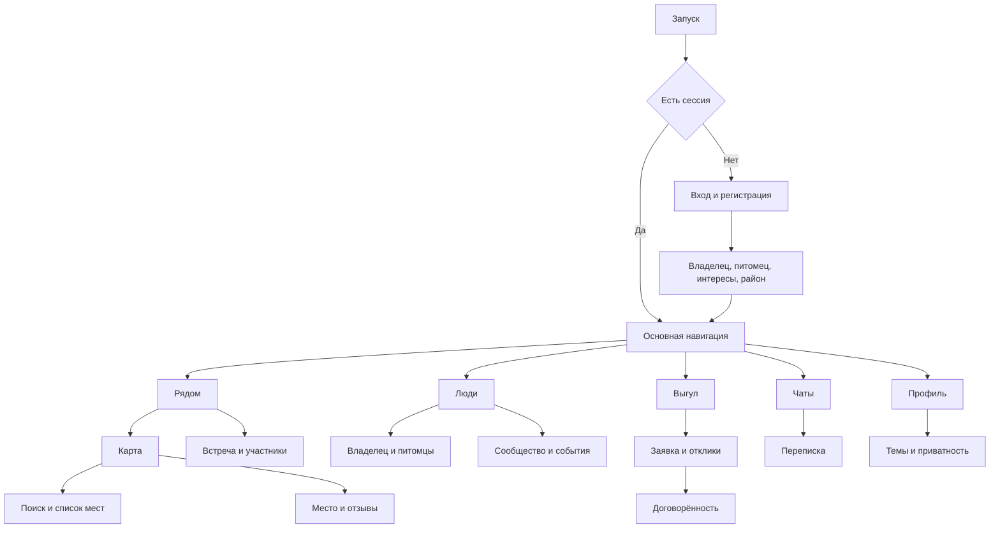

# Дизайн PetFriendly

Версия 1.0 · 8 октября 2026 года. Базовый дизайн для первой версии iOS и Android — Studio: минимализм, крупные заголовки, спокойные поверхности и лаймовый акцент. Шрифты — Manrope и Golos Text. Интерактивный макет находится в `../design/prototype.html`, машинные настройки — в `../design/tokens.json`.

## Стартовый город и вход

Первый рынок запуска — Минск. При первом открытии «Рядом» запрашивается доступ к геолокации: с разрешением карта открывается вокруг пользователя, без него предлагается ручной выбор города с Минском по умолчанию. Ручной выбор запоминается и не меняется автоматически при перемещении; кнопка «Рядом со мной» возвращает режим геолокации. В других городах предусмотрен пустой результат при отсутствии мест или участников. Экран входа содержит email и пароль, восстановление пароля и кнопки «Продолжить с Google», «Продолжить с Apple», «Продолжить с Telegram». Кнопка Google соответствует входу через Google-аккаунт, а не доступу к почте Gmail.

Новый пользователь проходит подтверждение email при парольной регистрации. Для Telegram email не обязателен; настройки предлагают добавить подтверждённый адрес для связи и восстановления. Все варианты ведут к одному сценарию создания профиля. Способы входа находятся также в разделе безопасности; их привязка требует подтверждения владения аккаунтом. Эти экраны входят в спецификацию, реальные провайдеры ещё не подключены к макету.

## Визуальная система

Manrope используется в заголовках и словесном знаке petfriendly. Golos Text — в тексте, элементах управления, метаданных и сообщениях. В релизе шрифты поставляются с приложением, вместе с лицензиями. Набор должен включать кириллицу и латиницу; загрузка шрифтов по сети не нужна.

Заголовок экрана — 32/36, вес 700; заголовок карточки — 18/23, вес 600; основной текст — 15/22.5; подписи — 12/17. Цвет, размеры, интервалы и длительности берутся из tokens.json. Основные отступы — 24, между блоками — 24–32, внутри карточек — 20–24. Радиус карточек — 24, кнопок — 14, нижних панелей — 28.

| Назначение | Светлая тема | Тёмная тема |
|---|---|---|
| Фон | #F9F9F6 | #141614 |
| Поверхность | #FFFFFF | #20231F |
| Основной текст | #20251E | #F4F5EF |
| Вторичный текст | #62695C | #A6ADA0 |
| Разделитель | #E4E7DD | #33392F |
| Акцент | #D6ED8A | #D6ED8A |
| Текст на акценте | #253314 | #253314 |

Лаймовый цвет используется в главном действии и активной навигации. Длинный текст остаётся нейтральным. Рейтинг, статус и ошибка всегда имеют текстовое обозначение. Тёмная тема включает карту, панели, диалоги, клавиатуру и системные области.

Тема по умолчанию — системная. Выбор светлой или тёмной темы сохраняется локально и применяется до первого кадра приложения. В прототипе переключатель расположен в шапке для сравнения; в мобильном релизе основной переключатель находится в настройках профиля.

## Навигация

## Экраны

| Экран | Содержание и основное действие |
|---|---|
| Рядом | Район, приглашение на прогулку, места и события; переход к карте |
| Карта | Главный экран «Рядом»: верхний блок события; город и переходы над картой с отступами 24 px и скруглением 24 px; иконки категорий и кластеры. Масштаб и своя позиция — кнопками только в полноэкранном режиме |
| Список мест | Отдельный экран: поиск, категории, избранное, допуск животных по данным источника, сортировка |
| Карточка места | Фото, название, расстояние, рейтинг и число отзывов; удобства, правила, комментарии, избранное и маршрут |
| Люди | Владельцы с питомцами и интересами; фильтры, профиль и начало переписки |
| Сообщество | Описание, участники, правила, события и тематический чат; вступление |
| Встреча | Организатор, время, место, ограничения и участники; запись или отмена участия |
| Выгул | Запросы, помощники с рейтингом и собственные договорённости; создать запрос или откликнуться |
| Заявка | Питомец, длительность, время, район и инструкции; отклики и выбор помощника |
| Чаты | Личные, групповые и событийные разговоры; непрочитанные сообщения |
| Переписка | История, поле ввода, вложения, статусы отправки; сообщение |
| Профиль | Владелец и питомцы; интересы, рейтинг помощника, завершённые выгулы, отзывы и настройки |
| Модерация | Жалобы, точки и отзывы для проверки; отдельный интерфейс с ролью модератора |

Все сущности питомца поддерживают вид животного, а не только собак. «Рядом» сохраняет приветствие Studio и блок ближайшей встречи в выбранном городе над картой. Списка мест на основной странице нет. Список доступен отдельным экраном из кнопки на карте и работает без разрешения геолокации. Иконки дерева, чашки, лапы и приборов отличают категории; группы близких мест сохраняют числовой счётчик.

Карточка на карте открывается нижней панелью. Компактное состояние показывает название, рейтинг и расстояние; развёрнутое — фотографии, правила и отзывы. Жест вниз закрывает панель, закрытие также доступно кнопкой. При открытии сдвигается центр карты, чтобы выбранная точка не оказалась за панелью.

## Рейтинг пользователей в роли помощников

В профиле помощника показывается блок: «★ 4,8 · 12 отзывов» и отдельная подпись «18 завершённых выгулов». Это пример оформления, а не реальные данные. В откликах достаточно оценки и числа отзывов; подробности открываются из профиля.

Карточка отзыва содержит звёзды, комментарий, отображаемое имя автора и дату. Метка «По завершённому выгулу» означает связь с договорённостью в приложении. Помощник может опубликовать ответ; меню карточки позволяет пожаловаться. Точные адреса, маршруты и приватные инструкции не публикуются.

После завершения владелец получает предложение «Как прошла прогулка?» с выбором 1–5 звёзд и необязательным комментарием. Перед отправкой показано, что отзыв будет публичным. Без отзывов отображается «Пока нет отзывов», без числовой оценки. Рейтинг не является гарантией безопасности; число отзывов всегда видно рядом с ним.

Общий социальный балл за знакомства и сообщения в первой версии не вводится. Пользователь получает репутацию за конкретную роль и выполненные действия. Если позже понадобится оценка владельцев, она проектируется отдельно, с защитой от ответных оценок.

## Компоненты и состояния

Базовые компоненты: основная и вторичная кнопки, фильтры, поисковое поле, аватар владельца и питомца, строка места, карточка встречи, карточка заявки, рейтинг, нижняя панель, уведомление и сообщение чата.

Каждый экран предусматривает загрузку, пустой результат, ошибку с повтором и отсутствие сети. Фильтры и введённый текст сохраняются после возврата назад. Заблокированный пользователь не может начать новую переписку. Отправляемое сообщение имеет статусы «отправляется», «отправлено» и «не отправлено» с повторной отправкой.

## Безопасность и приватность в интерфейсе

В профиле предусмотрены два явных раздела. «Безопасность аккаунта» содержит MFA, способы входа, активные сессии и выход со всех устройств. «Приватность» содержит видимость профиля, геолокацию, блокировки, экспорт и удаление данных. Изменение критичных настроек требует повторной аутентификации. Для push по умолчанию скрыт текст сообщений; в переключателе приложений скрывается приватный контент.

Публично показывается район. Точный адрес передачи питомца виден только участникам договорённости. [Правила защиты аккаунтов и данных](security.md) обязательны для реализации этих экранов. Эти экраны описаны в спецификации; MFA и управление сессиями ещё не подключены к демонстрационному макету.

## Анимации

| Событие | Поведение | Время |
|---|---|---|
| Нажатие | Scale 1 → 0.97 → 1, без сдвига соседей | 100 мс |
| Смена раздела | Fade и подъём на 6 px | 180 мс |
| Открытие подробностей | Небольшой slide и fade | 220 мс |
| Нижняя панель | Плавный подъём; интерактивное закрытие жестом | 250 мс |
| Смена темы | Интерполяция цветов фона и текста | 220 мс |
| Избранное | Короткий scale и смена заполнения сердца | 180 мс |
| Успешное действие | Смена состояния кнопки и короткое уведомление | 180 мс |

Кривая — cubic-bezier(0.2, 0, 0, 1). Анимации не задерживают ввод и сетевые операции. При reduced motion пространственные анимации отключаются, темы меняются сразу. Тактильный отклик возможен при избранном и подтверждении договорённости; настройка позволяет его отключить.

Во Flutter: ThemeData и ThemeExtension для токенов, AnimatedTheme для темы, AnimatedSwitcher для состояния, AnimationController только для жестов и сложных переходов. Настройка уменьшения движения учитывается через платформенные параметры MediaQuery.

## Доступность и критерии готовности

Минимальная область нажатия — 44×44; для Material контролов предпочтительно 48×48. Текст поддерживает системное увеличение, экран не ограничивает доступный размер шрифта. Контраст основного текста — не ниже 4.5:1. Иконки имеют подписи для VoiceOver и TalkBack. Фокус панели возвращается к открывшему её элементу.

Проверка макета и будущего Flutter приложения: светлая/тёмная/системная темы, ширины 320/390/430, увеличенный текст, отказ в геолокации, отсутствие сети, переполненные и пустые списки. Карта должна иметь доступную альтернативу списком.

## Граница макета

Прототип показывает пять разделов, темы, шрифты, переходы, фильтры, избранное, карточку места и демонстрационную переписку. Подложка живой карты, реальные фотографии, серверные данные, push и жесты нативного приложения реализуются при разработке. Географическое оформление карты задаётся отдельным светлым и тёмным стилем Mapbox с приглушёнными дорогами и акцентными маркерами.

## Источники

- [Manrope](https://fonts.google.com/specimen/Manrope)
- [Golos Text](https://fonts.google.com/specimen/Golos+Text)
- [Mapbox Flutter SDK](https://docs.mapbox.com/flutter/maps/guides/)

## Профиль, выгул и сообщества — обновление 8 октября 2026

Личный кабинет: компактная строка с изображением человека, именем, районом и описанием. Питомцы — небольшие карточки с отдельной иконкой/фото, видом, возрастом и характером. Редактирование — иконкой; добавление питомца — плюс рядом с заголовком. Избранное остаётся в профиле, настройки вынесены на /settings; шестерёнка находится рядом с переключателем темы на вкладке «Я».

Выгул: карточка содержит питомца, дату и время, длительность, район владельца (без адреса), характер, публичное описание, статус, число откликов и владельца. Действия — текстовые кнопки, без тяжёлых заливок. Время Минска отображается как UTC+3; другие города пока используют время устройства с явной пометкой.

Люди: две отдельные вкладки «Люди рядом» и «Сообщества», поиск внутри выбранной вкладки. В людях показываются район и интересы, без выдуманного расстояния. Сообщества имеют обложку, описание, количество участников и статус своего участия. Карточка открывает /group/:id: описание, участники и организатор, вступление, чат, приглашение и выход.

Приглашение открывает черновик личного сообщения, отправка остаётся явным действием пользователя. Ссылка в сообщении открывает сообщество; получатель вступает сам. Чат показывает имя автора, дату/время и состояние отправки. Из чата сообщества доступен список участников. Добавления людей без согласия нет.

Фотографии профиля, питомца и сообщества: системный выбор изображения и локальный предпросмотр в памяти до перезапуска. Изображение перекодируется в PNG без исходных EXIF, не загружается на сервер. В отсутствие фото используется понятная иконка, для сообщества — спокойная графическая обложка. Серверное хранение фотографий требует отдельного подключения приватного Storage; текущий дизайн не означает, что оно реализовано.

## Календарь, список мест и вход — финальные правки

Календарь и встроенные подписи Flutter локализованы на русский язык; неделя начинается с понедельника. Заголовок даты уменьшен, поверхность нейтральная, текущая дата выделена контрастным контуром, выбранная — лаймовым кругом с тёмным текстом. Время выбирается в формате 24 часов.

Список мест строит строки лениво и открывает порции по 40 записей, догружая их при приближении к концу списка. Поиск, фильтры и смена города сбрасывают порцию и прокрутку. Текущий OSM-каталог заранее находится в локальном кэше для карты; это пагинация представления поверх кэша, без отдельного сетевого запроса на каждую порцию.

Кнопка «Добавить место» открывает название, категорию, описание и выбор точки перемещением карты под центральное перекрестие. Геолокация пользователя не подставляется автоматически. Добавляйте публичные объекты, без домашних адресов. Предложение видно автору на карте/в списке как непроверенное; общий каталог пополняется после модерации. Допуск питомцев и рейтинг не выдумываются.

Авторизация: иконка питомца по центру без цветной подложки, компактный заголовок и пояснения по центру; иконка использует onSurface для обеих тем. Email/пароль с иконками, одно основное действие; регистрация и восстановление в одной строке. Google, Apple и Telegram представлены небольшими кнопками с узнаваемыми знаками и доступными подписями. Их наличие в дизайне не означает, что провайдеры уже подключены.

## Избранное и карточка места — актуальная версия

Избранные места показаны непосредственно в личном кабинете, с категорией и оценкой при наличии отзывов. Отдельного списка в модальном окне нет. Карточка места содержит название, категорию/город, допуск питомцев, «Показать на карте», избранное и форму отзыва: 1–5 звёзд, комментарий и публикация. После отправки видны свой отзыв и средняя оценка. Один пользователь оставляет один отзыв о месте; сервер проверяет авторство и уникальность. В списках мест без оценок отсутствует пустая надпись, оценённые показывают среднее число и иконку звезды.

«Показать на карте» открывает полный экран с центром/масштабом выбранного места; ручной город не меняется. Из карточки на уже открытой полной карте кнопка возвращает к ней и центрирует место. Общий технический текст об OpenStreetMap и описание механики приложения убраны из карточки. Атрибуция остаётся у карты/каталога и в «Настройки → О приложении и данных».

### Автодополнение города

Выбор города показывает до шести подсказок из локального списка 22 городов Беларуси. Поиск понимает русские, белорусские и английские названия; выбранная подсказка сохраняет каноническое название. Можно ввести другой город вручную или вернуться к режиму «Рядом со мной». Ручной выбор не перезаписывается геолокацией.

### Модальные окна

Нижние модальные окна открываются в корневом Navigator поверх всего приложения. Затемнение закрывает шапку, содержимое и нижнюю навигацию, блокирует нажатия на фон. Это правило действует для выбора города и темы, карточки места, списка мест в одной точке карты и приглашений в сообщество. Календарь, часы и диалоги безопасности также используют корневой Navigator.

Нижнее меню отделяется тонкой верхней границей border и фоном surface: белым в светлой теме и более светлым, чем фон экрана, в тёмной. Лаймовый индикатор выбранной вкладки сохраняется. Граница рисуется поверх фона меню, чтобы её не перекрывал Material.

### Каталог и поля ввода — актуальные решения

Автоматически загружаются только парки и площадки для собак. Кафе и рестораны доступны для ручного предложения пользователями с последующей модерацией. Каталог следует выбранному/определённому городу; показываются загрузка, ошибка с повтором и отдельное пустое состояние. Запоздавшие ответы старого города не подменяют список нового. Для Минска офлайн-пакет содержит 130 мест.

Текст input выровнен сверху слева, включая многострочные описания, сообщения и отзывы. Подпись label и floating label используют одинаковый textSecondary в текущей теме, независимо от фокуса; она больше не становится бледно-лаймовой. Select наследует те же цвета подписей.

## Завершение первого входа

После подтверждённого входа сервер проверяет MFA и собственный профиль. Для незаполненного профиля открывается «Давайте познакомимся»: редактируемое имя, необязательные район/описание/интересы, фото из Google при наличии или выбор из галереи. Имя провайдера — предложение в поле, ранее сохранённое имя не заменяется. Фото загружается в предпросмотр только по нажатию; публикация имени/фото выполняется кнопкой «Сохранить и продолжить». Фото можно отменить, оно не обязательно.

Google может не передать имя/фото — остаётся ручной ввод. В текущем Apple OAuth имя не приходит; первый нативный Apple-вход требует отдельной реализации захвата имени, повторный не гарантирует его. Apple/Telegram пока не подключены. Фото не хранится в профиле внешним URL: после подтверждения проходит существующий upload-photo/private Storage/read-photo.

## Дизайн-ревью Studio — 9 октября 2026

Выполнены пять приоритетов и дополнительные правки из `.impeccable/critique/2026-10-09T12-04-24Z__lib-app-app-dart.md`:

- Выгул: репутация и профиль видны в отклике до выбора помощника; выбор подтверждается, повторная отправка блокируется, результат объясняется. Активные договорённости идут раньше общего списка; завершённые доступны в истории. В личном профиле показан опыт выгула. Новые помощники остаются видимыми без нулевых звёзд.
- Чаты: последнее сообщение, отправитель, время и компактный счётчик непрочитанного; отдельные загрузка, ошибка с повтором и настоящее пустое состояние. Предпросмотры и сообщения клиента остаются в памяти; при смене аккаунта очищаются.
- Рядом: сохранены приветствие и встреча над картой; баннер компактнее и имеет одно действие. «Места списком» подписано явно. На узком экране и при крупном тексте фильтры открываются в отдельном нижнем окне, содержимое прокручивается.
- Люди/сообщества: отдельные сохраняемые поисковые запросы, результат после фильтрации, понятное отсутствие совпадений и сброс поиска.
- Типографика: заголовки карточек 18, основной текст 15, заголовки секций 24; сохранены Manrope/Golos Text, обе темы и лаймовый акцент. Заголовки и основные действия имеют семантические роли.

Отзывы требуют явного выбора звёзд; показаны даты, ответы помощника и жалоба на конкретный отзыв. Ответ доступен только назначенному помощнику для опубликованного отзыва завершённой договорённости. Оценки и опыт не являются гарантией безопасности.

Дата встречи/выгула вводится в часовом поясе места и хранится как UTC-момент с IANA-зоной. Для известных городов Беларуси используется Europe/Minsk; для другого города организатор явно выбирает зону. Неоднозначное или пропущенное время при смене DST отклоняется. Старые записи без известной зоны показывают UTC с пояснением. Даты сессий читаемые; без фото используются инициалы или спокойная иконка.

Проверено: 58 Flutter-тестов, включая поиск, крупный текст, выбор помощника, inbox и часовые пояса; анализатор без замечаний. Семантика проверена на уровне виджетов, полный проход VoiceOver/TalkBack ещё не выполнен. Изменения относятся к Flutter-приложению; `design/prototype.html` остаётся отдельным обзорным прототипом.

## Следующие улучшения взаимодействия — 9 октября 2026

Выполнены одобренные следующие предложения:

- Договорённость о выгуле показывает пять этапов и одну инструкцию для текущей роли/состояния. Отмена имеет отдельное пояснение. Весь индикатор читается как одна семантическая сводка; он не является live tracking.
- Из договорённости владелец/назначенный помощник открывает существующую переписку. Из переписки доступны связанное сообщество, конкретная встреча или заявка. Переходы через push сохраняют черновик сообщения и прокрутку при возврате; серверное членство остаётся обязательным.
- Формы предупреждают перед выходом с изменениями: продолжить, удалить изменения или оставить черновик. Черновики существуют только в памяти, восстанавливаются при повторном открытии той же формы, очищаются после успешного сохранения и при смене/очистке аккаунта. Фото и приватные инструкции не записываются на диск. Кнопки называют действие: создать встречу/сообщество, опубликовать заявку, добавить/сохранить питомца.
- После первого заполнения профиля показан один короткий выбор: место для прогулки, знакомство с владельцами или помощь с выгулом. Можно сразу перейти к карте; новая постоянная настройка не введена.
- Допуск питомцев разделяет неподтверждённые сведения, подтверждение сообщества и подтверждение заведения. Подтверждение не означает разрешение: запрет также показывается явно. Дата наблюдения, условия и основание появляются только из отдельной модерируемой записи. OSM-теги остаются подсказками каталога. Ошибка получения сведений отличается от отсутствия подтверждения.
- Шторки используют единое время 250 мс/220 мс и отключают анимацию при reduced motion; нажатия тоже отключают анимацию. Проверены подписанные цели нажатия, размеры и контраст первого шага в обеих темах, крупный текст, фокус клавиатуры внутри шторки и семантика этапов. Это не заменяет полный проход VoiceOver/TalkBack.

Проверено: 76 Flutter-тестов и чистый анализатор. В iOS Simulator проверены инструкция выгула и сохранение/возврат/удаление черновика; проверка выявила и устранила повтор города в подписи даты. Полный Android визуальный проход и настоящий VoiceOver/TalkBack остаются открытыми пунктами.

## Визуальное уточнение Studio — все семь предложений

- Прогресс выгула по умолчанию показывает текущий этап и следующую инструкцию. «Все этапы» раскрывает вертикальную последовательность с текущим/завершённым состоянием. При reduced motion используется мгновенное изменение без AnimatedSize.
- Supporting-информация (люди, репутация, отзывы, правила посещения, пояснения безопасности) опирается на интервалы и разделители. Питомцы, встречи, сообщества и заявки сохраняют объектные поверхности. StudioCard больше не рисует обязательный контур; outlined включается явно.
- ScreenIntro имеет компактный вариант 24 для задач, чатов, отзывов и безопасности. Выразительное приветствие Nearby сохранено. Заголовки и разделы имеют семантические роли.
- MetadataLine задаёт единый caption для района, даты, продолжительности, участников и опыта. Дата встречи не повторяет город; актуальный город сохраняется, даже если название зоны отличается. Даты отзывов читаемые. Generic-подсказка встроенного каталога не повторяется над разделом правил; реальные описания мест сохранены.
- Основное действие зависит от состояния: создание в списке встреч, вступление в конкретную встречу, чат после вступления, следующий шаг договорённости. Обновление, отчёт о проблеме, приглашение и выход спокойнее. Отмена, блокировка и удаление отделены и используют error-токен.
- Dark background, surface и sheet (#272C25) различаются; secondary text #BBC2B4, border #41483C. Диалоги/шторки не получают автоматический seed tint. design/tokens.json версии 1.1.0 отражает эти решения. Основной и secondary текст имеют contrast >=4.5:1 на пяти семантических поверхностях в обеих темах.
- Фото person/pet квадратные с центральным cover; community covers едины 2:1 в списке, деталях и форме. Thumbnails identity декодируются под размер экрана. Без фото остаются инициалы/нейтральная иконка. Название сообщества предшествует обложке для быстрого сканирования.

Проверка: 83 Flutter-теста прошли, после финального уточнения place sheet прошли ещё 10 затронутых проверок; анализатор чистый. Контраст сверяется с JSON-токенами; есть проверки фото/placeholder frames на узкой и широкой ширине, крупного кириллического текста, компактного прогресса и иерархии действий встреч. iOS просмотр показал более спокойный профиль помощника, раздел отзывов места и личный профиль. Полный Android визуальный проход и VoiceOver/TalkBack остаются отдельными проверками.

### Иконка приложения

Launcher icon: тёмная лапа с сердцем на Studio lime #D6ED8A, без текста, градиентов и нарисованной рамки. Векторный источник — assets/branding/app-icon.svg; scripts/generate-app-icons.cjs создаёт iOS opaque RGB PNG и Android legacy/adaptive assets через sharp. Название на устройстве — PetFriendly.

## Mobile minimalist refinement — 9 октября 2026

Studio сохранён. Общая шапка уменьшена с 76 до 60, Profile section headings используют 18, как card titles, чтобы person/pet identity оставались главными. Nearby сохраняет приветствие и banner; уменьшены внешние интервалы для более высокой карты, без уменьшения touch targets.

Unread counts используют нейтральную subtle поверхность с читаемым textPrimary; лайм остаётся у основной кнопки и выбранной навигации. В inbox сегодняшняя активность показывает HH:mm, более ранняя — короткую дату, за другой год — с годом. Внутри переписки дата остаётся полной с годом и временем.

CommunityCover без фото показывает компактную иконку рядом с названием; реальные фото сохраняют 2:1 и центральный cover. Это действует в списке/деталях/форме; Высокий пустой блок обложки больше не показывается. Новые параметры layout/media записаны в design/tokens.json.

Полная Flutter suite: 84 теста прошли, analyze чистый. Изменения не добавляют backend-модели или постоянные пользовательские настройки.

## City, progress and place-sheet corrections — 10 октября 2026

- Выбор города: пустой поиск, текущий город с отметкой, короткий список альтернатив и прямой выбор строки. Нет второго общего подтверждения и вводящих в заблуждение стрелок. Произвольный город имеет явную отдельную строку; отправка клавиатуры сама не меняет город. Рядом со мной остаётся отдельным действием; manual city не перезаписывается.
- Этапы выгула всегда видны: пятисегментная линия, текущий этап и x/5, подписи всех стадий. На узком экране/крупном тексте подписи перестраиваются без accordion/collapse. Отмена не показывает фиктивный прогресс. Инструкция по роли сохранена. Это заменяет прежний раскрываемый вариант.
- В community chat нет перехода обратно в community — ни contextual header link, ни кнопки открыть community по ссылке в сообщении. Back возвращает в существующий экран. Приглашения в личной переписке сохранены; события/договорённости по-прежнему имеют свой контекст.
- PlaceDetailsSheet имеет стабильную высоту 86% viewport с прокручиваемым содержимым. Появление feedback не меняет верхнюю границу шторки; место оценки в metadata зарезервировано, чтобы rating не сдвигал соседние элементы. Загрузка отзывов имеет ясное состояние и retry при ошибке.
- Favorite и Close — простые иконки20 с полными touch targets в header. Показать на карте — спокойное текстовое действие без большой заливки. Фокус места, inline review и избранное сохранены.

Проверка: все 96 Flutter-тестов прошли, analyze чистый. Тест с задержанной Future проверяет одинаковые координаты sheet frame и map action до/после feedback и рейтинга. Навигационный тест трижды открывает чат и возвращается Back, включая group URL в сообщении. City tests покрывают Беларусь/Россию/произвольный город, отсутствие выбора от клавиатуры, nearby callback и320px2x. iOS просмотр проверил city sheet и place sheet в dark theme. [Place sheet](screenshots/place-sheet-stable-dark-ios.png). Серверные права/миграции не менялись.

### Empty reviews and corrections — 10 октября 2026

Отзывы используют компактный заголовок18 и спокойное «Пока нет отзывов» вместо повторного приглашения к форме выше. Utility action переименовано в «Исправить данные места», перенесено в блок информации до divider/feedback и получает нейтральный цвет/обычный вес. Оно больше не выглядит частью отзывов. Существующий correction route и модерация сохранены. Place/review и delayed-loading проверки прошли; analyze чистый.

### Вложения и маркеры карты — 10 октября

Чат: спокойная кнопка «+» рядом с полем, выбор Фото/Видео в root sheet, компактный draft с удалением, необязательная подпись и единая кнопка отправки. Изображение внутри пузыря открывается целиком с zoom; видео — отдельной кнопкой с длительностью и ручным play/sound. Автор и время сохраняются. Mine controls используют onLime, тема применяется к fullscreen viewer.

Положение пользователя отделено от категорий мест синей иконкой с чёткой белой обводкой; никаких дополнительных кнопок на встроенной карте. Pin выбора места лаконичный, тема управляет его контрастом, кончик соответствует camera center. Source attribution и городские фильтры сохраняются.

### Content-fit place sheets — 10 October 2026

Place sheets use their content height, capped at 86% of the viewport, rather than filling that height. The footer keeps 16 logical pixels plus the bottom safe inset. Initial reviews, pet-access evidence and moderation availability resolve before presentation, with a cancellable opening notice for slow loads. Provider subscriptions stay alive until dismissal; repeated taps and navigation cancellation prevent duplicate or stale opens. Long content remains scrollable. Regression coverage checks delayed feedback, fitted short content with a home-indicator inset, cancellation and the existing review/map flow. iOS preview: `docs/screenshots/place-sheet-content-fit-ios.png`.

### Visible place actions — 10 October 2026

Map and data-correction actions share a row of outlined buttons, with dark readable labels and compact icons. They stack on narrow screens or with enlarged text. The correction label is “Исправить данные”. Header favorite/close controls use outlined icon buttons; publishing a review uses a filled primary button, and retry/moderation/more-review actions have outlines. Content-fit sheet sizing is retained.

### Place sheet action hierarchy — 10 October 2026

Map and correction controls use 48px minimum targets, 12px corners and short single-line labels: “На карте” and “Уточнить данные”. Map has a soft neutral fill, made more visible in dark mode; correction keeps a quieter outline. Header controls use neutral filled surfaces. Rating guidance precedes the stars, a comment is explicitly optional, selection is exposed through semantics, and disabled map actions have a distinct appearance and explanatory tooltip. Light/dark native captures are `docs/screenshots/place-sheet-refined-light-ios.png` and `docs/screenshots/place-sheet-refined-dark-ios.png`. Six focused tests cover delayed loading, cancellation, content fit, review/map behavior and 320px/2× text in both themes; analysis is clean. Independent bounded design reassessment: 36/40 for this sheet, compared with 27/40 before. Native VoiceOver usability and real-user research remain unverified.

### Minimal place-sheet controls — 10 October 2026

Following the user’s preference for a quieter UI, map and correction actions share one compact 44px-minimum row with a single fine border and small separator. They stack at enlarged text/narrow widths. Favorite and close return to plain icons with full hit targets and semantics. The review heading is compact, comment starts at one line and grows to four, and the publish action uses a smaller 44px target with 8px corners. Rating guidance, disabled states and content-fit sheet sizing are retained. Light/dark native previews: `docs/screenshots/place-sheet-minimal-light-ios.png` and `docs/screenshots/place-sheet-minimal-dark-ios.png`. Six focused tests pass, and the edited sheet’s analysis and layout detector are clean. The prior 36/40 assessment applied to the previous styling; this refinement has not been rescored.

### Text actions and absent-content spacing — 10 October 2026

Place actions now use compact underlined icon-and-text links without boxes, fills, equal-width slots or an action-bar container. They wrap naturally with enlarged text, preserving 44px minimum targets. Map/correction controls are omitted when the corresponding coordinates/source ID are missing. Publication also uses an underlined text action. Unrated metadata no longer reserves the former 80px rating slot plus gap. Optional descriptions carry their spacing only when present. Empty reviews show one concise message without an empty heading; review rows have no final divider or extra footer padding. Shared MetadataLine collapses to zero size with no values, city rows omit absent subtitles, and compact SectionTitle uses 18px/8px spacing. Regression tests verify sparse place geometry, empty captions, home-indicator footer space and enlarged-text controls. Full Flutter suite: 121 passed; analysis of edited UI files and layout detector clean. Native screenshot: `docs/screenshots/place-sheet-text-actions-ios.png`.

### Rounded controls and consistent sheets (2026-10-10)

The approved Studio controls now use compact capsules rather than heavy outlines or underlined links. Filled controls represent final actions; soft neutral controls represent supporting actions, with transparent text controls reserved for low emphasis. Buttons and icon controls retain at least 48 logical pixels of touch area. Place actions keep complete labels and stack on narrow screens or with larger text. Material pressed/focus states remain enabled; submission controls show progress and prevent repeat taps, with nearby prerequisite guidance.

City and place filter selectors use quiet filled surfaces and chevrons. Place, city, evidence and theme sheets share an aligned semantic heading and close placement. Sheet height follows content up to the viewport limit; safe-area padding remains, and absent metadata, descriptions, actions and empty favorite headings do not reserve decorative space. Empty guidance needed for onboarding and unrated walking reputation remains visible.

### Minimal walking empty state (2026-10-10)

The walking screen shows Helpers only when other profiles exist. Empty open requests use one concise message without an orphan section heading. Populated walking section headings use the compact type scale. The duplicate demo footer was removed from this screen; the persistent app-header demo badge still identifies the preview. No synthetic helpers are inserted into the unseeded preview.

### Chat compose placement (2026-10-10)

New conversation is a compact compose icon aligned to the right of the Chats title, with the accessible label and tooltip “Новая переписка” and a 48-pixel touch target. It remains available in empty, loading and populated inbox states. The subtitle sits below the header; the empty state's Find company action retains its separate purpose. The duplicate demo footer is omitted on Chats, with demo status still visible in the app header.

### Cohesive chat empty state (2026-10-10)

Following Carbon's empty-state anatomy and Atlassian's next-step guidance, the empty inbox is a single width-constrained group: muted decorative icon, concise title, explanatory copy and one content-width rounded action. All elements share centered alignment; the group occupies the empty content area beneath the persistent Chats/compose header. This centered arrangement is a PetFriendly mobile adaptation, not a requirement of the cited guidance. SliverFillRemaining with intrinsic content sizing lets the group use available space and still scroll at narrow widths, shorter screens or enlarged text. Loading, failure and populated inboxes remain separate states; cached conversations remain visible on refresh failure. No placeholder conversations or additional actions were introduced.

References: https://www.carbondesignsystem.com/building-blocks/core/patterns/empty-states and https://atlassian.design/components/empty-state/.

### Nearby map fallback and toolbar (2026-10-10)

The unconfigured embedded map no longer reserves a large map canvas. Nearby instead scrolls its content naturally and shows a compact, left-aligned unavailable notice with one actual “Открыть список мест” recovery action. The duplicate toolbar list action and fullscreen control are hidden in this configuration; manual city selection remains available. When configured, the embedded map retains its normal map area and fullscreen navigation, with a quiet filled list control matching the city selector. Map load failures also show the same actionable notice within LiveMap. This does not configure Mapbox or change location permission/session behavior.

This follows Carbon empty-state guidance: short contextual explanation, one next action, and a layout appropriate to the unavailable content.

### Screen structure and progressive disclosure (2026-10-10)

Nearby retains the Studio wordmark and greeting. Other main tabs use one title in the shared app bar, with compose beside Chats and theme/settings beside Profile; the demo/alpha badge remains visible. Body introductions retain helpful context without repeating the page title. Standalone Chats and Walking widgets can still render their own heading when not inside the app shell. Header height adapts for enlarged text.

Place search and category remain immediately available; advanced options are grouped in the filter sheet, with an active-filter count and visible applied choices. Place details show published reviews before composition. “Оставить отзыв” reveals the editor inline in the same sheet. Editing does not introduce another modal or hide/reset the draft. Existing own reviews and pending places retain their established eligibility rules.

### Quieter sheet titles (2026-10-10)

Shared sheet headings use Manrope 20/26, weight600 and subtle -0.2 tracking instead of 23px bold display styling. This gives long place names more room without truncation or font shrinking. Title padding aligns the first line with the existing 48px Favorite/Close controls; semantic heading labels remain intact.

### Flat unavailable-map controls (2026-10-10)

The Nearby unavailable-map area now consists of a compact row of rounded city/list controls and one muted availability line. It has no notice card, decorative map icon or duplicate explanatory paragraph. The list action keeps its accessible tooltip and routes to the selected-city catalog; controls wrap at narrow widths or large text. Configured maps retain their canvas and fullscreen action. The fuller actionable fallback remains for map runtime errors outside this compact unconfigured state.

### Nearby places navigation row (2026-10-10)

The former pair of city/list capsules is replaced by a section header (“Места рядом”) with a quiet city picker and a full-width list navigation row underneath. Thin horizontal separators, a list icon and trailing chevron mark the row as interactive without an individual button container. The entire row has a minimum56px touch region and explicit button semantics. City selection keeps its48px target/key/callback; fullscreen remains beside the section header only for a configured map. The compact availability note remains below the row.

### Profile hierarchy and clear actions (2026-10-10)

Profile applies Material list guidance (short, consistent headlines/supporting details/actions) and keeps general settings separate as Apple HIG recommends. The personal identity card uses a 64 px photo, 20 px Manrope name, district and a labelled Edit action. A camera affordance marks photo editing. Bio/interests appear only when meaningful; their spacing is conditional. The district-only privacy explanation sits next to identity instead of a distant footer.

Pets retain compact identity cards and real metadata. Empty pets have a labelled Add action; populated pets use the section add action. Blank temperament does not reserve a line. Walking-helper reputation remains role-specific, with no-review text instead of zero stars and a link to detailed reviews. Favorite places remain inline; empty favorites link to the catalog, while retained favorite IDs distinguish loading/failure/unavailable data from having saved nothing. The duplicate demo footer is removed; status remains in the app header. Authentication, photo storage and reputation eligibility are unchanged.

Sources: https://github.com/material-components/material-components-android/blob/master/docs/components/List.md and https://developer.apple.com/design/human-interface-guidelines/settings.
